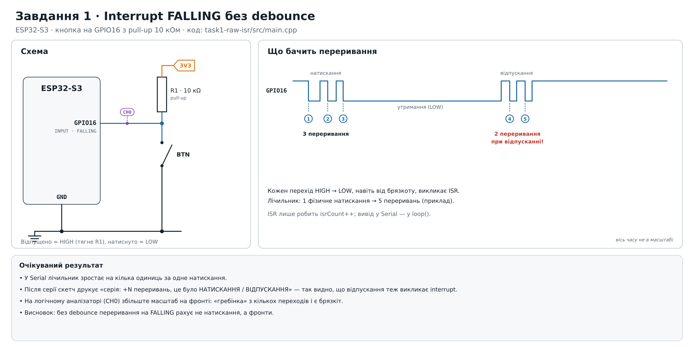
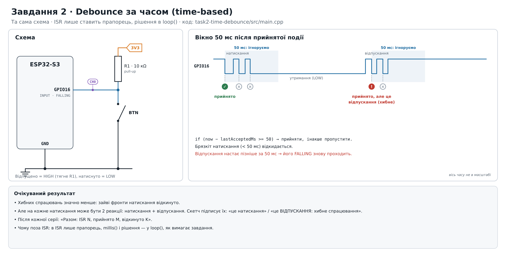
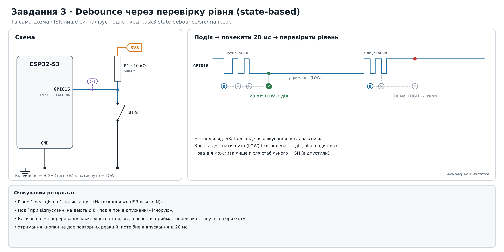
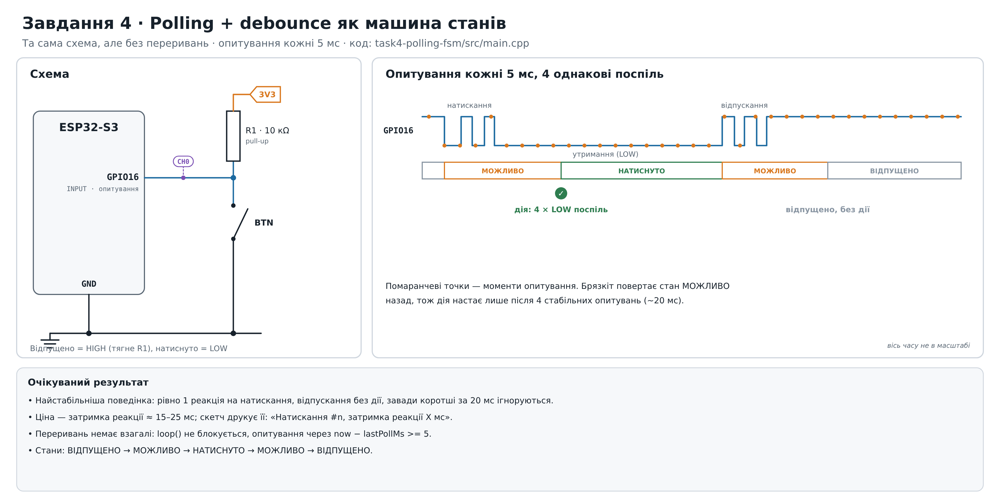
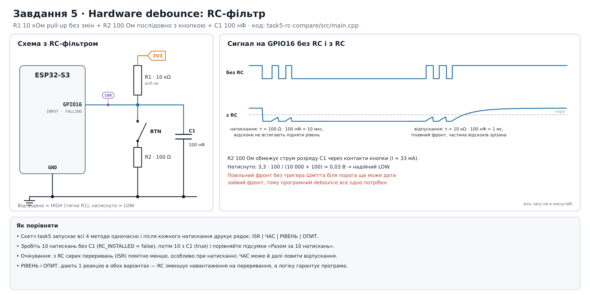

# Усунення брязкоту контактів кнопки (ESP32-S3)

Плата: ESP32-S3 DevKitC, PlatformIO + Arduino Framework.

Кожна папка є окремим проєктом PlatformIO: відкрийте її через PlatformIO → Open Project, потім Upload і Monitor (115200).

| Папка | Завдання |
|---|---|
| `task1-raw-isr` | 1. Interrupt FALLING без debounce |
| `task2-time-debounce` | 2. Debounce за часом (50 мс), логіка поза ISR |
| `task3-state-debounce` | 3. Debounce через перевірку рівня |
| `task4-polling-fsm` | 4. Polling кожні 5 мс + машина станів, без переривань |
| `task5-rc-compare` | 5. Стенд порівняння всіх методів з RC-фільтром і без нього |

## Підключення (завдання 1–4)

| Звідки | Куди |
|---|---|
| GPIO16 | одна ніжка кнопки |
| друга ніжка кнопки | GND |
| R1 10 кОм | між GPIO16 і 3V3 (pull-up) |
| Логічний аналізатор CH0 | GPIO16, GND аналізатора на GND |

Відпущена кнопка = HIGH, натиснута = LOW. У коді `pinMode(BTN_PIN, INPUT)`, бо підтяжка зовнішня.

## Підключення (завдання 5, RC-фільтр)

R1 10 кОм залишається. Додаються: R2 100 Ом послідовно з кнопкою (кнопка → R2 → GND) і C1 100 нФ між GPIO16 і GND.

- Натискання: C1 розряджається через R2, τ = 100 Ом · 100 нФ = 10 мкс. R2 обмежує струм розряду через контакти (≈ 33 мА).
- Відпускання: C1 заряджається через R1, τ = 10 кОм · 100 нФ = 1 мс.

## Схеми

### Завдання 1

### Завдання 2

### Завдання 3

### Завдання 4

### Завдання 5

## Результати симуляції

> **Це результати симуляції, а не вимірювання на платі.** Скетчі з цього репозиторію зібрано з емулятором Arduino і подано на вхід модель кнопки з випадковим брязкотом (папка `simulation/`, запуск `sh run.sh`). Для звіту бажано повторити ті самі серії на реальній платі і поставити поруч свої числа.

### Модель

- 10 натискань, утримання 150–400 мс, пауза 0,5–0,9 с.
- Брязкіт натискання: 0–5 відскоків (контакт розмикається на 5–80 мкс); у моделі він тривав від 0 до 1,24 мс, у середньому 0,48 мс. Орієнтир: брязкіт ~0,8 мс з 5 імпульсами, виміряний раніше логічним аналізатором.
- Брязкіт відпускання: 0–3 короткі повторні замикання, тривалість 0,13–0,53 мс; у 5 з 10 натискань.
- RC: R1 10 кОм, R2 100 Ом, C1 100 нФ, поріг входу 1,5 В без гістерезису, шум на вході σ = 5 мВ (з кореляцією ~20 мкс).
- Два переривання, ближчі за 2 мкс, зливаються в одне (час входу в ISR).

### Завдання 1–4, без RC, 10 натискань

| Метод | Реакцій на 10 натискань | З них при відпусканні | Примітка |
|---|---|---|---|
| 1. ISR без debounce | 41 | 11 (у 5 відпусканнях) | натискання дали 30 переривань, від 1 до 6 на одне |
| 2. Час 50 мс | 15 | 5 (хибні) | усі зайві фронти натискання відкинуто, хибні лише від відпускань |
| 3. Перевірка рівня | 10 | 0 | 5 подій при відпусканні проігноровано |
| 4. Polling + FSM | 10 | 0 | затримка 15 мс від першого LOW-опитування (≈ 15–20 мс від фізичного натискання) |

### Завдання 5: з RC і без RC (стенд `task5-rc-compare`, ті самі 10 натискань)

| Метод | Без RC, разом за 10 | З RC, разом за 10 |
|---|---|---|
| ISR (сирі переривання) | 41 | 11 |
| ЧАС 50 мс | 15 | 11 |
| РІВЕНЬ | 10 | 10 |
| ОПИТ. | 10 | 10 |

Покроково без RC (ISR / ЧАС / РІВЕНЬ / ОПИТ.): 4/2/1/1, 4/2/1/1, 1/1/1/1, 4/1/1/1, 6/1/1/1, 2/1/1/1, 6/2/1/1, 4/1/1/1, 5/2/1/1, 5/2/1/1.

З RC усі натискання дали 1/1/1/1, крім №8: 2/2/1/1. Там шум на повільному фронті відпускання (τ = 1 мс) один раз перетнув поріг двічі.

### Висновки

- Без debounce одне натискання дає 1–6 переривань, а відпускання з брязкотом додає ще 1–3: FALLING рахує фронти, а не натискання.
- Вікно 50 мс прибирає брязкіт натискання, але не відпускання: 5 хибних спрацювань із 15.
- Перевірка рівня і polling з машиною станів дають рівно 10 реакцій на 10 натискань. Polling обходиться без переривань, але реагує із затримкою ≈ 15–20 мс.
- RC-фільтр зменшив сирі переривання з 41 до 11 (майже 1 на натискання) і майже прибрав хибні спрацювання методу «час». Повільний фронт відпускання без тригера Шмітта все ж може дати зайвий фронт, тому програмний debounce потрібен і з RC.

