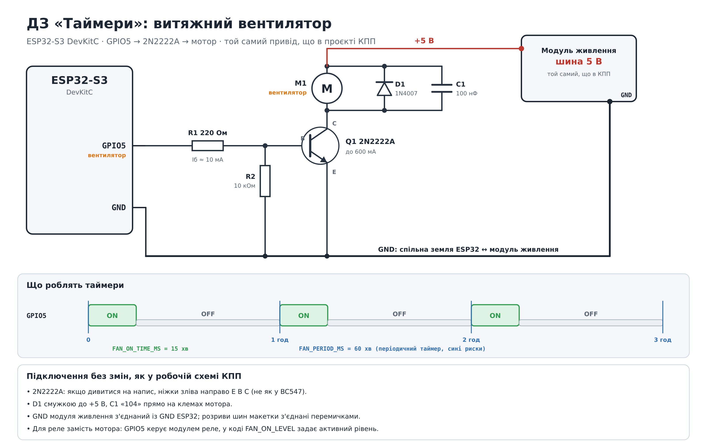
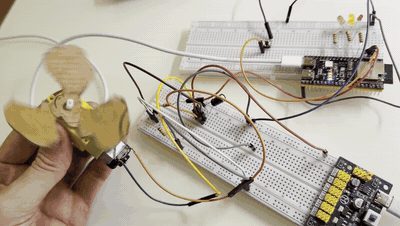

# ДЗ 2.5 «Таймери»: витяжний вентилятор (ESP32-S3)

Плата: ESP32-S3 DevKitC (N16R8), PlatformIO + Arduino Framework.

## Задача

Витяжний вентилятор щогодини вмикається на 15 хвилин, після чого автоматично вимикається.

- Вентилятор = двигун (через транзисторний ключ 2N2222A).
- Таймери працюють незалежно від коду в `loop()`.
- `delay()` не використовується.
- Цикл повторюється без участі `loop()` і без власних задач.
- Час роботи і період задаються макросами.

## Схема

Апаратна частина та сама, що в приводі проєкту «КПП-автомат», змінюється лише код.



| Звідки | Куди |
|---|---|
| GPIO5 | R1 220 Ом → база 2N2222A |
| База 2N2222A | R2 10 кОм → GND |
| Емітер 2N2222A | GND |
| Колектор 2N2222A | мотор → +5 В модуля живлення |
| D1 1N4007 | паралельно мотору, смужкою до +5 В |
| C1 100 нФ | паралельно мотору, на його клемах |
| GND модуля живлення | GND ESP32 |

2N2222A, якщо дивитися на напис: ніжки зліва направо **E B C**.

## Як працює

Використано `esp_timer`: на ESP32-S3 він працює на апаратному системному таймері SYSTIMER.

| Таймер | Тип | Що робить |
|---|---|---|
| `periodTimer` | періодичний, `FAN_PERIOD_MS` | вмикає вентилятор і запускає `offTimer` |
| `offTimer` | одноразовий, `FAN_ON_TIME_MS` | вимикає вентилятор |

```
GPIO5  ┌──┐        ┌──┐        ┌──┐
       │ON│  OFF   │ON│  OFF   │ON│  OFF
───────┘  └────────┘  └────────┘  └────────
       |<-15 хв->|
       |<------ 60 хв ------>|
```

- Колбеки таймерів викликає системна служба `esp_timer`. Цикл «увімкнути → вимкнути» повторюється сам: `loop()` у ньому не бере участі, власних задач немає.
- Періодичний таймер переозброюється від моменту попереднього спрацювання, а не від кінця колбека, тому похибка не накопичується.
- `setup()` лише створює таймери й запускає перший цикл одразу після старту.
- Щоб показати незалежність, `loop()` навмисно зайнятий сторонньою роботою: рахує прості числа до 400000. Вентилятор при цьому перемикається точно за розкладом.

## Налаштування

У `src/main.cpp`:

| Макрос | Значення | Що задає |
|---|---|---|
| `FAN_PERIOD_MS` | `60 * 60 * 1000` | період (1 година) |
| `FAN_ON_TIME_MS` | `15 * 60 * 1000` | час роботи (15 хвилин) |
| `DEBUG_FAST` | `1` / `0` | `1`: період 12 с, робота 3 с (та сама пропорція 1/4) |
| `FAN_PIN` | `5` | пін керування |
| `FAN_ON_LEVEL` | `HIGH` | активний рівень (для модуля реле з активним LOW: `LOW`) |
| `LOOP_BUSY_DEMO` | `1` / `0` | стороння робота в `loop()` для демонстрації |

`static_assert` не дасть зібрати проєкт, якщо час роботи не менший за період.

## Запуск

1. Відкрити папку в PlatformIO → Open Project.
2. Upload, потім Monitor (115200).
3. Для реального режиму поставити `DEBUG_FAST 0`.

## Результат

### Очікуваний вивід (симуляція розкладу, режим налагодження)

Це вивід симуляції таймерів на комп'ютері, не з плати: `results/simulation-log.txt`.

```
Витяжний вентилятор: період 12 с, робота 3 с (режим налагодження)
[    1000 ms] вентилятор ON, цикл 1, вимкнеться через 3 с
[    4000 ms] вентилятор OFF, наступне ввімкнення через 9 с
[   13000 ms] вентилятор ON, цикл 2, вимкнеться через 3 с
[   16000 ms] вентилятор OFF, наступне ввімкнення через 9 с
[   25000 ms] вентилятор ON, цикл 3, вимкнеться через 3 с
```

### Відео з плати

[](Video/IMG_7059.MOV)

Режим налагодження (`DEBUG_FAST 1`): 3 с замість 15 хвилин і 12 с замість години. На відео вентилятор крутиться до ~3-ї секунди, потім ~9 с стоїть і на ~11,5 с вмикається знову.

Повне відео зі звуком: [Video/IMG_7059.MOV](Video/IMG_7059.MOV). Оригінал у форматі HEVC відкривається в Safari або QuickTime; GIF-прев'ю вище показується просто на GitHub.
