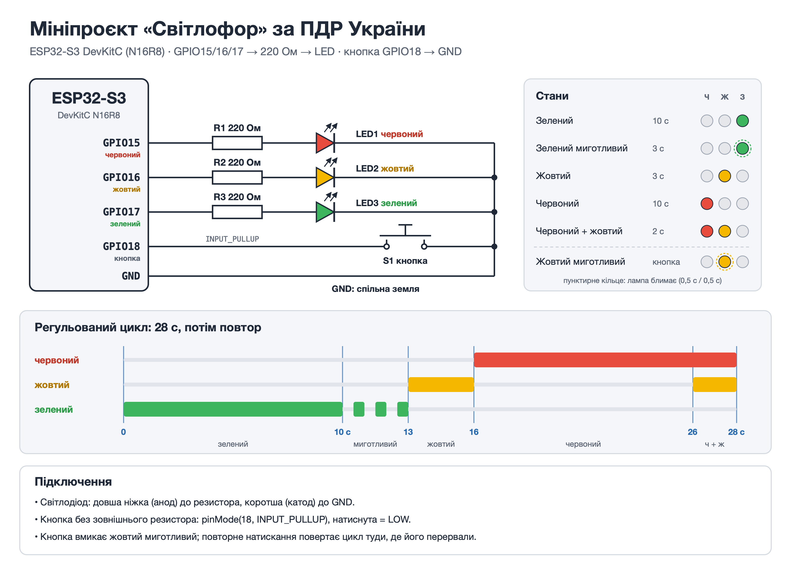
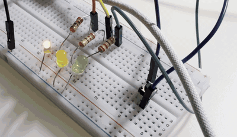

# Мініпроєкт модуля 2 «Світлофор» (ESP32-S3)

Плата: ESP32-S3 DevKitC (N16R8), PlatformIO + Arduino Framework.

## Задача

Додати до коду із заняття стани світлофора відповідно до ПДР України.

Стандартна послідовність:

- Зелений: дозволяє рух.
- Зелений миготливий: час дозволеного сигналу закінчується, скоро ввімкнеться заборонний.
- Жовтий: забороняє рух і попереджає про зміну сигналів.
- Червоний: забороняє рух.
- Червоний і жовтий разом: скоро ввімкнеться зелений, рух ще заборонено.
- Зелений: цикл повторюється.

Особливий випадок: жовтий миготливий дозволяє рух і попереджає про нерегульоване перехрестя чи пішохідний перехід. Тут він вмикається кнопкою.

- Стани описані в `enum`.
- Час відмірює апаратний таймер.
- `delay()` не використовується.

## Схема



| Звідки | Куди |
|---|---|
| GPIO15 | R1 220 Ом → анод червоного світлодіода |
| GPIO16 | R2 220 Ом → анод жовтого світлодіода |
| GPIO17 | R3 220 Ом → анод зеленого світлодіода |
| Катоди світлодіодів | GND |
| GPIO18 | кнопка S1 → GND |

Анод — довша ніжка світлодіода. Кнопці зовнішній резистор не потрібен: пін налаштовано як `INPUT_PULLUP`, тож відпущена кнопка = HIGH, натиснута = LOW.

Піни 15–18 стоять поруч у верхньому ряду плати. GPIO 22–25 на ESP32-S3 немає, а 26–32 зайняті flash-пам'яттю. Не варто брати й інші піни:

- 0, 3, 45, 46 — від них залежить завантаження;
- 19, 20 — USB;
- 35–37 — PSRAM;
- 48 — вбудований RGB-світлодіод.

## Як працює

### Стани

| Стан (`State`) | Лампи | Тривалість | Далі |
|---|---|---|---|
| `Green` | зелений | 10 с | `GreenBlink` |
| `GreenBlink` | зелений блимає | 3 с (3 блимання) | `Yellow` |
| `Yellow` | жовтий | 3 с | `Red` |
| `Red` | червоний | 10 с | `RedYellow` |
| `RedYellow` | червоний + жовтий | 2 с | `Green` |
| `YellowBlink` | жовтий блимає, 1 Гц | поки не натиснуть кнопку | збережений стан |

### Апаратний таймер

- Таймер 0 з дільником 80 рахує на частоті 1 МГц і викликає переривання кожні 500 мс (`TICK_MS`) з автоперезапуском.
- Переривання `onTimer()` лише збільшує лічильник `pendingTicks`. Лічильник спільний з `loop()`, тому доступ до нього захищено критичною секцією (`portMUX_TYPE`).
- `loop()` забирає накопичені тіки й для кожного викликає `onTick()`. Той рахує час у поточному стані і, коли час вийшов, перемикає на наступний.
- 500 мс — половина періоду блимання, тому один таймер відмірює і тривалість станів, і блимання.

### Лампи

`applyLamps()` вираховує лампи зі стану й номера тіку в ньому. У миготливих станах парний тік — одна фаза, непарний — інша. Тому після повернення в збережений стан лампи і фаза блимання одразу правильні.

### Кнопка

- Кнопка опитується в `loop()`. Натискання зараховується, коли рівень протримався `DEBOUNCE_MS` (30 мс) без змін. Брязкіт контактів при натисканні й відпусканні зайвих перемикань не дає.
- Перше натискання запам'ятовує поточний стан і час у ньому (`savedState`, `savedTicks`) і вмикає `YellowBlink`.
- Друге натискання відновлює збережене: цикл продовжується з того самого місця й доводить залишок часу до кінця. Тік, що йшов у момент натискання, губиться, тому залишок може бути до 0,5 с коротшим.

## Налаштування

У `src/main.cpp`:

| Константа | Значення | Що задає |
|---|---|---|
| `PIN_RED` / `PIN_YELLOW` / `PIN_GREEN` | `15` / `16` / `17` | піни світлодіодів |
| `PIN_BUTTON` | `18` | пін кнопки |
| `TICK_MS` | `500` | період апаратного таймера (половина періоду блимання) |
| `DEBOUNCE_MS` | `30` | антибрязкіт кнопки |

- Тривалості станів задаються в `durationTicks()`, а порядок — у `nextState()`.
- Тривалість має бути кратною `TICK_MS`.

## Запуск

1. Відкрити папку в PlatformIO → Open Project.
2. Upload, потім Monitor (115200).
3. Лог іде в USB-порт, підключений напряму до ESP32-S3: у `platformio.ini` увімкнено `ARDUINO_USB_CDC_ON_BOOT=1`.

## Результат

### Очікуваний вивід (симуляція)

Це вивід симуляції на комп'ютері, а не з плати. Прошивку зібрано із заглушками замість Arduino, а тіки таймера й натискання кнопки (з брязкотом контактів) подаються програмно. Кнопку натиснули під час зеленого миготливого (11 200 мс) і ще раз на 15 100 мс. Повний лог разом зі станом ламп: `results/simulation-log.txt`.

```
[      0 ms] GREEN
[  10000 ms] GREEN_BLINK
[  11237 ms] YELLOW_BLINK (saved GREEN_BLINK at 2/6 ticks)
[  15137 ms] GREEN_BLINK (resumed at 2/6 ticks)
[  17000 ms] YELLOW
[  20000 ms] RED
[  30000 ms] RED_YELLOW
[  32000 ms] GREEN
[  42000 ms] GREEN_BLINK
[  45000 ms] YELLOW
```

- Зелений миготливий перервали на 2-му з 6 тіків. Після повернення він відпрацював решту 4 тіки (2 с) і перейшов у жовтий.
- Від натискання до реакції 37 мс: 30 мс антибрязкоту, відлічених від останнього відскоку контактів.
- Брязкіт при відпусканні кнопки зайвих перемикань не дав.

### Відео з плати

[](Video/IMG_7083.MOV)

Що видно на відео (час зчитано з кадрів із кроком 0,25 с):

| Час на відео | Стан |
|---|---|
| 0–5,5 с | червоний (запис почався посеред нього) |
| 5,5–7,5 с | червоний + жовтий, 2 с |
| 7,5–17,5 с | зелений, 10 с |
| 17,5–20,5 с | зелений миготливий: 3 блимання |
| 20,5–23,5 с | жовтий, 3 с |
| 23,5 с | червоний |
| ≈ 25,2 с | натискання кнопки: жовтий миготливий, 0,5 с горить / 0,5 с ні |
| ≈ 27,2 с | друге натискання: знову червоний, цикл продовжився з того самого місця |

Повне відео зі звуком: [Video/IMG_7083.MOV](Video/IMG_7083.MOV). Оригінал у форматі HEVC відкривається в Safari або QuickTime; GIF-прев'ю вище показується просто на GitHub.
